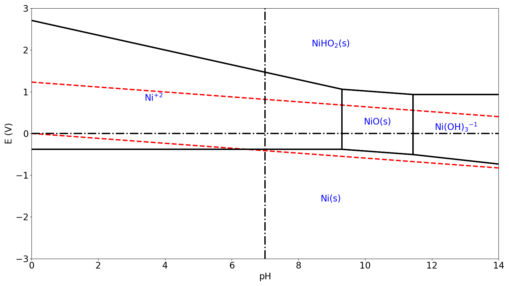

# Pourbaix Diagram Generator

Generate Pourbaix diagrams for single- or multi-element systems in water, using
[pymatgen](https://pymatgen.org/) ([A Robust, Open-Source Python Library for Materials
Analysis. Computational Materials Science, 2013, 68,
314–319.](https://doi.org/10.1016/j.commatsci.2012.10.028)) and data from the [Materials
Project](https://next-gen.materialsproject.org/) API.

This project started as my first exploration of pymatgen, which also makes it a good
starting point if you're taking your first steps with the package.

## Background

I built this tool while working in applied electrochemistry research at Fontys University
of Applied Sciences, where it was and still is used in water electrolysis (PEM/LAWE/AEM)
and carbon dioxide electroreduction (CO2ER) projects funded by among others [SIA RAAK-PRO
(ALMA)](https://regieorgaan-sia.nl/praktijkgericht-onderzoek/uitgelichte-projecten/pionieren-als-lint-lector/)
and
[RELEASE](https://smartport.nl/project/release-reversible-large-scale-energy-storage/).

The diagrams created with this tool are used to visualize the thermodynamic stability of
various species in aqueous solutions as a function of pH and potential. They are
particularly useful for understanding the behavior of metals and their oxides in
different electrochemical environments, which is crucial for designing and optimizing
electrochemical processes. The diagrams are used in presentations and educational
materials to teach and communicate complex electrochemical concepts in a clear and
intuitive manner.

## Getting started

Requires [uv](https://docs.astral.sh/uv/) and [just](https://just.systems/).

1. Clone the repository and install the dependencies:

   ```bash
   git clone https://github.com/karelplanken/pourbaix.git
   cd pourbaix
   just install
   ```

2. Get a Materials Project API key at <https://next-gen.materialsproject.org/api> and put
   it in a `.env` file in the repository root (`.env` is git-ignored):

   ```bash
   MP_API_KEY=<your-api-key>
   ```

3. Enter the element(s) of your choice in `main()` in `src/pourbaix/__main__.py`:

   ```python
   def main() -> int:
       ...
       compounds: list[str] = ['Fe', 'Ni']
       ...
   ```

4. Generate the diagram, running from the repository root:

   ```bash
   uv run pourbaix
   ```

   Entries are fetched from the Materials Project API only if they aren't already cached
   in `pourbaix_entries/`. The diagram is shown on screen and saved as
   `pourbaix_diagrams/<elements>.png`.

See the docstrings in `src/pourbaix/__main__.py` for details on the available functions.

## Sample Pourbaix diagrams

The 📁 `pourbaix_diagrams` directory contains pre-generated Pourbaix diagrams. Below is
an example:

 Figure: Pourbaix diagram for
Nickel

## Pourbaix entries

The 📁 `pourbaix_entries` directory contains Pourbaix entries for various elements, saved
as JSON files. Feel free to add your own entries.

## Development

### Tooling

`codespell` and `prek` install via `just install`. `gitleaks` is a standalone binary,
install separately, pinned to match `prek.toml`:

```bash
GITLEAKS_VERSION=8.30.1
curl -sSL -o gitleaks.tar.gz "https://github.com/gitleaks/gitleaks/releases/download/v${GITLEAKS_VERSION}/gitleaks_${GITLEAKS_VERSION}_linux_x64.tar.gz"
tar xzf gitleaks.tar.gz gitleaks
sudo mv gitleaks /usr/local/bin/
rm gitleaks.tar.gz
gitleaks version
```

If you use VS Code, install the Python extension alongside the Ruff extension — otherwise
Ruff-in-editor can silently fall back to a PATH/bundled binary instead of the
`uv.lock`-pinned one in your venv.

### Git hooks

```
just install-hooks    # one-time: installs prek's git hook shims (see prek.toml)
```

Runs formatting, type checks, and complexity checks automatically before each commit,
plus commit message / branch-name conventions (commitizen), generic file hygiene, spell
checking, and secret scanning. Install this once per clone.

### Dev commands

```
just format              # ruff check --fix + ruff format
just check-format        # ruff format --check (non-mutating)
just check-types         # mypy
just check-complexity    # complexipy
just check-spelling      # codespell
just check-secrets       # gitleaks, staged changes only — run before committing
just check-versions-sync # gitleaks pin in prek.toml vs. installed binary
just test                # pytest + coverage
just check               # format + types + complexity + spelling + version-sync + test bundle
```

`check-secrets` is deliberately not part of the `just check` bundle — it only makes sense
once something's staged. Run it (or rely on the `install-hooks` git hook) before every
commit.

`codespell`, like `ruff`/`mypy`/`complexipy`, is a venv dependency — its pre-commit hook
just runs `just check-spelling`, so there's a single pin (`pyproject.toml`) and nothing
to drift. `gitleaks` is a standalone binary outside the venv, pinned separately in
`prek.toml` and the README install snippet above; `just check-versions-sync` (also wired
in as a prek hook) checks the installed binary against that pin so the two can't silently
drift apart.

## Contributing

If you have suggestions, improvements, or bug reports, please feel free to open an issue
or submit a pull request. Your contributions are highly appreciated!

## License

This project is licensed under the MIT License. See [LICENSE](LICENSE).

Happy Pourbaix diagram generating! 🧪📊
